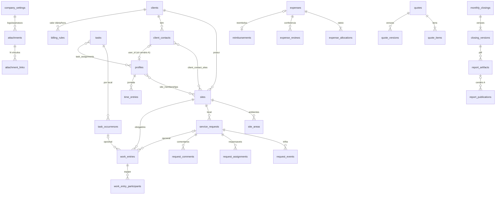

# 04 — Modelo de dados

> Etapa 1 — 25/10/2026. PostgreSQL (Supabase). Dinheiro em centavos (`BIGINT`), timestamps em UTC (`timestamptz`), datas de negócio em `date` (America/Sao_Paulo). Todas as tabelas têm `id uuid PK default gen_random_uuid()`, `created_at`, `updated_at`; tabelas de negócio têm `created_by`.

## 1. Visão geral



## 2. Entidades

Tipo de coluna abreviado: `txt`, `int`, `big` (centavos), `num(p,s)`, `bool`, `ts` (timestamptz), `date`, `uuid`, `jsonb`, `enum`.

### 2.1 Configuração e cadastros

**`company_settings`** (linha única, `id = 1`)
`legal_name`, `trade_name`, `cnpj`, `address` jsonb {logradouro, numero, complemento, bairro, cidade, uf, cep}, `phone`, `email`, `website`, `logo_attachment_id`, `signature_attachment_id`, `technical_manager_name`, `technical_manager_title`, `crea`, `report_footer_text`, `quote_declaration_text` (modelo da declaração do ORC p.5), `upload_limits` jsonb {max_image_mb, max_pdf_mb, max_files_per_upload}, `retention_policy` jsonb, `activity_backdate_limit_days` int.
Regra: toda versão de relatório/orçamento **copia** os campos usados para `header_snapshot` — mudar a configuração não altera PDFs antigos (R-01).

**`clients`**
`kind` enum(`pf`,`pj`), `legal_name`, `display_name` (usado no nome do arquivo), `document` (CPF/CNPJ), `billing_info` jsonb (opcional), `notes_internal` txt, `is_active` bool.

**`client_contacts`** — pessoas do lado do cliente, **sem conta por padrão**
`client_id` FK, `name`, `email`, `phone`, `role_title`, `user_id` uuid NULL FK `profiles` (**preenchido só no cenário A**), `is_active`, `anonymized_at` ts NULL (LGPD).
Índice: `(client_id)`; `UNIQUE (user_id) WHERE user_id IS NOT NULL`.

**`client_contact_sites`** (N:N) — `client_contact_id`, `site_id`, `can_open_requests` bool, `can_view_reports` bool. PK composta.

**`sites`** — obras e unidades
`client_id` FK, `name`, `code` txt UNIQUE, `site_type` enum(`obra_temporaria`,`unidade_recorrente`), `status` enum(`ativa`,`pausada`,`encerrada`), `address` jsonb, `planned_start` date, `planned_end` date, `notes_internal`, `quote_id` uuid NULL (origem em orçamento aprovado, R-68).
Índices: `(client_id, status)`.

**`site_areas`** — `site_id`, `name`, `sort_order`, `is_active`. UNIQUE `(site_id, name)`.

**`profiles`** (1:1 `auth.users`)
`id` = `auth.users.id`, `full_name`, `phone`, `role` enum(`admin`,`worker`,`foreman`,`client`), `is_active` bool, `deactivated_at`.
Observação: o valor `client` existe no enum desde a primeira migração para evitar migração de tipo depois; **nenhuma policy ou tela usa esse valor até a decisão Q1**.

**`site_memberships`** — `profile_id`, `site_id`, `active_from` date, `active_to` date NULL, `created_by`. PK composta `(profile_id, site_id, active_from)`. Membership ativa = `active_to IS NULL OR active_to >= today`.

**Catálogos** (todos com `name`, `sort_order`, `is_active`, sem DELETE físico):
`service_categories`, `priority_definitions` (+ `sla_days` int NULL, `color_token`), `pending_reasons` (seed: falta de material, autorização, acesso, terceiro, outro), `suppliers` (+ `document`, `phone`, `notes`), `expense_categories`, `payment_methods` (dinheiro, PIX, cartão, boleto, transferência — editável), `task_kinds` (vistoria, visita técnica, recebimento de material, apoio à equipe, compra, atividade programada, outro).

### 2.2 Separação "pessoa do cliente" × "conta autenticada" (recomendação para Q1)

```
clients ──< client_contacts >── client_contact_sites >── sites
                 │
                 └── user_id (NULL hoje) ──> profiles(role='client')  [cenário A]
```

- Em **ambos** os cenários, `service_requests.requester_contact_id` aponta para o contato (quem pediu), e `created_by` aponta para quem registrou (admin ou, em A, o próprio contato).
- Cenário B não cria nenhuma conta; a tabela de contatos serve para solicitante, destinatário do relatório e histórico.
- Cenário A adiciona: convite, `user_id`, policies `client`. Zero migração destrutiva.

### 2.3 Chamados / OS

**`service_requests`**
`number` txt UNIQUE gerado `AAAA-NNNNNN` (sequence por ano; função `next_request_number()`), `client_id`, `site_id`, `site_area_id` NULL, `origin` enum(`cliente_portal`,`cliente_externo`,`interna`,`programada`), `channel` enum(`portal`,`whatsapp`,`telefone`,`email`,`presencial`,`outro`) NULL, `requester_contact_id` NULL FK `client_contacts`, `requester_name_free` txt NULL (quando o solicitante não está cadastrado), `title`, `description`, `service_category_id`, `priority_id`, `status` enum(`aberta`,`programada`,`em_execucao`,`pendente`,`executada`,`concluida`,`cancelada`), `scheduled_date` date NULL, `due_date` date NULL, `task_id` NULL, `opened_at` ts, `closed_at` ts NULL, `cancelled_at` ts NULL, `is_internal` bool (demanda interna invisível ao cliente), `current_pending` jsonb NULL (cache do último impedimento: motivo, providência, responsável, previsão), `version` int (lock otimista).
Índices: `(site_id, status)`, `(client_id, opened_at)`, `(status, due_date)`, `(scheduled_date)`.
Restrições: `status` **só muda via RPC** `request_transition(...)` (trigger bloqueia UPDATE direto em `status` fora da função — verifica `current_setting('app.in_transition')`).

**`request_assignments`** — `service_request_id`, `profile_id`, `is_primary` bool, `assigned_at`, `assigned_by`, `unassigned_at` NULL. Histórico de atribuição preservado (nunca DELETE).

**`request_events`** — **append-only** (sem UPDATE/DELETE para nenhum papel)
`service_request_id`, `event_type` enum(`abertura`,`classificacao`,`atribuicao`,`reprogramacao`,`prorrogacao`,`inicio`,`atividade`,`pendencia`,`retomada`,`execucao_informada`,`devolucao`,`validacao`,`cancelamento`,`reabertura`,`comentario`,`anexo_adicionado`,`anexo_revogado`,`edicao`), `from_status` NULL, `to_status` NULL, `actor_id`, `occurred_at` ts (= `created_at`; não editável), `reason` txt NULL, `payload` jsonb (ex.: pendência {pending_reason_id, next_action, next_action_owner_id, expected_return_date}; reprogramação {old, new}), `work_entry_id` NULL, `is_internal` bool.
Índices: `(service_request_id, occurred_at)`, `(occurred_at) WHERE to_status IS NOT NULL`.

**`request_comments`** — `service_request_id`, `author_id`, `body`, `is_internal` bool, `author_contact_id` NULL (cenário A). Sem DELETE; `hidden_at` + evento.

### 2.4 Agenda e tarefas

**`tasks`** — `title`, `description`, `kind_id` FK `task_kinds`, `priority_id`, `scheduled_date` date, `due_date` NULL, `status` enum(`planejada`,`em_andamento`,`concluida`,`cancelada`), `service_request_id` NULL, `created_by`.
**`task_assignments`** — `task_id`, `profile_id`, `assigned_at`, `assigned_by`.
**`task_occurrences`** — **uma por local atendido**
`task_id`, `site_id`, `site_area_id` NULL, `scheduled_date`, `status` enum(`prevista`,`iniciada`,`concluida`,`nao_realizada`,`cancelada`), `started_at`, `finished_at`, `no_show_reason` txt NULL (dia programado sem execução), `sort_order`.
Regra: criar uma tarefa cria ao menos 1 ocorrência; "desdobrar" adiciona ocorrências em outros `site_id` mantendo `task_id` (R-29). Ações de campo mudam `task_occurrences.status` via RPC `task_occurrence_transition`.

### 2.5 Fonte única de atividades

**`work_entries`** — o fato operacional
`site_id` NOT NULL, `site_area_id` NULL, `activity_date` date NOT NULL (data real do trabalho), `author_id`, `service_request_id` NULL, `task_occurrence_id` NULL, `kind` enum(`execucao`,`visita`,`vistoria`,`recebimento_material`,`apoio`,`compra`,`outro`), `description` NOT NULL, `solution` NULL, `materials` txt NULL, `hours_worked` num(5,2) NULL, `outcome` enum(`executado`,`parcial`,`nao_executado`), `blocker_reason_id` NULL FK `pending_reasons`, `next_step` NULL, `client_visible` bool default true, `review_status` enum(`enviado`,`revisado`,`ajustado`), `reviewed_by`, `reviewed_at`, `client_request_id` uuid NOT NULL (idempotência), `submitted_payload` jsonb (cópia do envio original do trabalhador, imutável — R-36).
Restrições: `UNIQUE (author_id, client_request_id)`; `CHECK (service_request_id IS NOT NULL OR task_occurrence_id IS NOT NULL OR kind <> 'execucao')` (execução sem vínculo deve ser `visita/vistoria/...`, isto é, avulsa declarada); `CHECK (activity_date <= current_date)`.
Índices: `(site_id, activity_date)`, `(service_request_id)`, `(task_occurrence_id)`, `(author_id, activity_date)`.

**`work_entry_participants`** — `work_entry_id`, `profile_id`. PK composta. O autor é participante por padrão.

**Diário = view `v_daily_log`** (não é tabela):
```sql
-- por (site_id, activity_date): work_entries + participantes + anexos + ocorrências previstas do dia + time_entries
-- COUNT(*) sobre work_entries; participantes agregados em array (nunca multiplicam linhas)
```
Invariantes anti-duplicidade (R-31, R-35):
1. "Registrar atividade" em uma OS **e** em uma tarefa ligada a essa OS gera **uma** linha com ambos os FKs.
2. Nenhum relatório soma `COUNT(work_entries)` com `COUNT(service_requests)`; são blocos distintos ("Atividades do dia" × "Chamados").
3. Transições de status geram `request_events`, não `work_entries`; apenas as ações "Registrar o que foi feito" e "Concluí" criam/usam `work_entry` (o evento aponta `work_entry_id`).

### 2.6 Jornada e cobrança (COMPLEMENTO M8)

**`time_entries`** — `profile_id`, `site_id`, `work_date` date, `hours` num(5,2) NULL, `billable` bool default true, `billing_units` num(6,2) default 1 (diárias), `notes`, `source` enum(`trabalhador`,`admin`), `approved_by` NULL, `approved_at` NULL, `client_request_id`.
`UNIQUE (profile_id, site_id, work_date)`. `hours` (jornada) e `billing_units` (cobrança) são conceitos independentes (R-34, D-10).

**`billing_rules`** — `client_id`, `site_id` NULL (NULL = todas as unidades do cliente), `unit_type` enum(`diaria`,`hora`), `unit_price_cents` big, `valid_from` date, `valid_to` date NULL, `show_in_client_report` bool default false, `notes`.
`EXCLUDE USING gist` para impedir vigências sobrepostas por (client, site, unit_type). Preço do dia = regra com `valid_from <= d AND (valid_to IS NULL OR d <= valid_to)`, preferindo `site_id` específico.
Demonstrativo mensal = `Σ billing_units × preço vigente(work_date)` sobre `time_entries` com `billable=true` do período. Exemplo de teste: 24 dias × 1 diária × 33.300 centavos = 799.200 centavos.

### 2.7 Anexos

**`attachments`** — `bucket` enum(`evidence`,`receipts`,`reports`,`branding`), `storage_key` txt UNIQUE, `original_name`, `mime_type` (validado), `size_bytes`, `width`, `height`, `content_hash`, `caption`, `uploaded_by`, `uploaded_at` ts, `upload_status` enum(`enviando`,`concluido`,`falhou`), `error_message`, `client_upload_id` uuid, `visibility` enum(`internal`,`client`) default `client` para fotos de evidência e `internal` para comprovantes, `revoked_at`, `revoked_by`, `revoke_reason`, `derivatives` jsonb {thumb_key, medium_key}.
`UNIQUE (uploaded_by, client_upload_id)`.

**`attachment_links`** — vínculo polimórfico controlado
`attachment_id`, `entity_type` enum(`service_request`,`work_entry`,`task_occurrence`,`expense`,`quote`,`site`,`company`), `entity_id` uuid, `evidence_role` enum(`inicial`,`intermediaria`,`resultado`,`comprovante`,`local`,`referencia`,`documento`), `sort_order`, `linked_by`, `linked_at`, `unlinked_at` NULL.
UNIQUE `(attachment_id, entity_type, entity_id)`. Um arquivo, N vínculos (R-41). A autorização resolve `entity → site_id` por função `attachment_site_ids(attachment_id)`.

### 2.8 Despesas (INTERNO)

**`expenses`** — `expense_date` date, `supplier_id` NULL, `supplier_name_free` NULL, `expense_category_id`, `description`, `items_notes`, `total_cents` big CHECK > 0, `payment_method_id`, `document_number`, `purchased_by` FK profiles, `paid_by_kind` enum(`empresa`,`colaborador`), `paid_by_profile_id` NULL, `service_request_id` NULL, `task_occurrence_id` NULL, `review_status` enum(`rascunho`,`enviado_para_conferencia`,`aprovado`,`devolvido_para_correcao`), `submitted_at`, `reviewed_at`, `reviewed_by`, `approval_version` int (incrementa a cada aprovação), `client_request_id` uuid, `notes`.
`UNIQUE (created_by, client_request_id)`.

**`expense_allocations`** — `expense_id`, `site_id` NOT NULL, `amount_cents` big CHECK > 0, `purpose` txt NOT NULL, `sort_order`.
UNIQUE `(expense_id, site_id)`.

**Regra de rateio (R-52)** — trigger de constraint **deferida** (`INITIALLY DEFERRED`) em `expenses` e `expense_allocations`:
```sql
-- ao fim da transação, para cada expense tocada:
--   (SELECT COALESCE(SUM(amount_cents),0) FROM expense_allocations WHERE expense_id = e.id) = e.total_cents
--   e existe ao menos 1 parcela
-- caso contrário RAISE EXCEPTION 'rateio_invalido: soma das parcelas (%) difere do total (%)'
```
Consequência: 1.000,00 = 600,00 + 400,00 passa; 600,00 + 399,99 falha; parcela negativa falha no CHECK; parcela sem obra falha no NOT NULL. Consolidado por obra = `SUM(expense_allocations.amount_cents)`; consolidado da empresa = `SUM(expenses.total_cents)` (= soma de todas as parcelas) — nunca os dois somados.

**`expense_reviews`** — append-only: `expense_id`, `action` enum(`enviada`,`aprovada`,`devolvida`,`invalidada`,`reenviada`), `actor_id`, `reason`, `snapshot` jsonb (total + parcelas no momento), `created_at`.

**Invalidação (R-54)** — trigger `AFTER UPDATE` em `expenses` (colunas `total_cents`, `expense_date`, `supplier_id`, `paid_by_*`) e `AFTER INSERT/UPDATE/DELETE` em `expense_allocations`: se `review_status='aprovado'` → grava `expense_reviews(action='invalidada')` e seta `review_status='enviado_para_conferencia'`. Aprovação registra `approval_version += 1`.

**`reimbursements`** — `expense_id` UNIQUE, `payee_profile_id`, `amount_due_cents`, `amount_paid_cents` default 0, `status` enum(`pendente`,`parcial`,`quitado`) (derivado por trigger), `settled_by`, `settled_at`, `settlement_notes`.
Criado automaticamente quando `paid_by_kind='colaborador'`; independe de `review_status` (R-55). Sem integração bancária.

### 2.9 Orçamentos (COMPLEMENTO M7)

**`quotes`** — `number` txt UNIQUE (`ORC-AAAA-NNNN`), `client_id`, `client_contact_id` NULL, `site_id` NULL, `service_location_text` (quando ainda não há obra), `issued_at` date, `valid_until` date, `execution_deadline_text` (ex.: "30 dias úteis"), `payment_terms`, `warranty_text` (ex.: "01 ano"), `observations`, `technical_notes`, `intro_text`, `declaration_text` (copiado do modelo em settings), `status` enum(`rascunho`,`enviado`,`aprovado`,`rejeitado`,`expirado`,`cancelado`), `total_cents` big (calculado), `accepted_at`, `accepted_by_note` (aceite manual: quem/como), `current_version_no` int.
**`quote_items`** — `quote_id`, `location_label` (ex.: "Cobertura"), `title`, `pricing_mode` enum(`global`,`detalhado`), `quantity` num(12,3) NULL, `unit` txt NULL, `unit_price_cents` NULL, `subtotal_cents` big NOT NULL, `notes` (ex.: "Garantia de 01 ano"), `sort_order`.
`CHECK (pricing_mode='global' OR (quantity IS NOT NULL AND unit_price_cents IS NOT NULL))`.
**`quote_item_lines`** — subitens/etapas descritivos: `quote_item_id`, `text`, `sort_order` (ex.: "Reparo/troca de rufos e calhas", "Aplicação de manta líquida… (667 m²)").
**`quote_versions`** — `quote_id`, `version_no`, `snapshot` jsonb (cabeçalho da empresa + cliente + itens + totais + extenso), `pdf_artifact_id` NULL, `created_by`, `reason`.
**`quote_attachments`** = `attachment_links` com `entity_type='quote'` e `evidence_role ∈ {local, referencia}`.

Regras: `total_cents = Σ subtotal_cents` (trigger); subtotal detalhado = `round_half_up(quantity × unit_price_cents)`; extenso gerado por `amount_in_words_pt_br(total_cents)` (teste: 760000 → "sete mil e seiscentos reais"); `expirado` calculado em leitura (`status='enviado' AND valid_until < today`) e materializado por job diário; **nenhuma FK** para `expenses` (R-67).

### 2.10 Fechamento mensal e relatórios

**`monthly_closings`** — `client_id`, `site_id` NULL (NULL = todas as unidades do cliente), `period_year` int, `period_month` int, `status` enum(`rascunho`,`fechado`), `current_version_id` NULL, `notes_internal`.
`UNIQUE (client_id, site_id, period_year, period_month)`.

**`closing_versions`** — **imutável após criação**
`closing_id`, `version_no` int, `cutoff_at` ts (UTC do fim do mês em SP), `generated_at`, `generated_by`, `criteria` jsonb (filtros, se demonstrativo habilitado, opções), `header_snapshot` jsonb (dados da empresa/cliente/unidade/resp. técnico na emissão), `payload` jsonb (ver §9), `summary` jsonb (contagens por seção), `reason` (motivo da nova versão), `supersedes_version_id` NULL.
`UNIQUE (closing_id, version_no)`.

**`report_artifacts`** — qualquer PDF/CSV gerado
`kind` enum(`fechamento_resumo`,`fechamento_detalhado`,`os_individual`,`diario`,`atividades_pessoa`,`despesas_internas`,`orcamento`,`csv_listagem`), `source_type` + `source_id` (ex.: `closing_version`), `file_name` txt (ex.: `Relatorio_Park_dos_Alpes_Setembro_2026.pdf`), `storage_key`, `status` enum(`na_fila`,`processando`,`pronto`,`falhou`), `attempts` int, `error_message`, `page_count`, `size_bytes`, `requested_by`, `started_at`, `finished_at`, `audience` enum(`interno`,`cliente`).
Índice: `(status) WHERE status IN ('na_fila','processando')` (fila com `FOR UPDATE SKIP LOCKED`).

**`report_publications`** — `report_artifact_id`, `closing_version_id`, `published_by`, `published_at`, `revoked_by`, `revoked_at`, `revoke_reason`, `delivery_note` (cenário B: "enviado por WhatsApp em dd/MM").
Existe nos dois cenários; só no A alimenta o portal.

### 2.11 Auditoria

**`audit_events`** — append-only: `actor_id`, `actor_role`, `entity_type`, `entity_id`, `action`, `before` jsonb NULL, `after` jsonb NULL, `reason`, `request_id` (correlação de log), `created_at`.
Trigger genérico em: `service_requests` (prioridade, prazo, status, responsável, cancelamento), `expenses`/`expense_allocations`, `reimbursements`, `work_entries` (ajustes do admin), `billing_rules`, `quotes`, `closing_versions`, `report_publications`, `profiles` (ativação), `site_memberships`, `company_settings`.

## 3. Numeração

- Chamado: `AAAA-NNNNNN` (ex.: `2026-000123`), sequência por ano com `INSERT … ON CONFLICT` em tabela `number_sequences(scope, year, last_value)` dentro da transação.
- Orçamento: `ORC-AAAA-NNNN`. Fechamento: `FEC-AAAA-MM-<código da unidade>-vN` (apenas exibição).

## 4. Ciclo de vida — Chamado/OS

```
            ┌──────────┐ triagem (admin: categoria, prioridade,  ┌─────────────┐
   abrir ──▶│  ABERTA  │──responsável, data)─────────────────────▶│ PROGRAMADA  │◀──────────────┐
            └────┬─────┘                                          └──────┬──────┘               │
                 │ cancelar (admin, motivo)                 iniciar (exec.)│   impedimento      │ reprogramar
                 │                                                        ▼        (motivo+     │ (admin)
                 │                                               ┌──────────────┐  providência) │
                 │                                               │ EM EXECUÇÃO  │──────────────▶├──────────────┐
                 │                                               └──┬───────┬───┘               │              │
                 │                            registrar atividade   │       │ concluí (solução + ≥1 foto)      │
                 │                            (work_entry, N vezes) │       ▼                   │       ┌──────▼──────┐
                 │                                                  │ ┌───────────┐             │       │  PENDENTE   │
                 │                                                  │ │ EXECUTADA │             │       └──────┬──────┘
                 │                                                  │ └──┬─────┬──┘             │              │ retomar (exec.)
                 │                              devolver p/ correção│    │     │ validar (admin)│◀─────────────┘
                 │                              (admin, motivo) ◀───┘◀───┘     ▼
                 │                                                       ┌───────────┐
                 ▼                                                       │ CONCLUÍDA │
            ┌───────────┐                                                └─────┬─────┘
            │ CANCELADA │◀──── cancelar (admin, motivo) de qualquer estado      │ reabrir (admin; motivo)
            └─────┬─────┘      não terminal                                     ▼
                  └──── reabrir (admin, motivo, raro) ─────────────────▶  ABERTA (H-01)
```

| De → Para | Quem | Pré-condições (validadas na RPC) | Evento |
|-----------|------|----------------------------------|--------|
| — → aberta | admin; client (A) | site acessível; `origin`/`channel`; contato ou nome livre quando origem é cliente | `abertura` |
| aberta → programada | admin | ≥1 responsável + `scheduled_date` | `classificacao`, `atribuicao` |
| programada → em_execucao | responsável, admin | — | `inicio` |
| em_execucao → em_execucao | responsável, admin | "Registrar o que foi feito" cria `work_entry` | `atividade` |
| programada/em_execucao → pendente | responsável, admin | `pending_reason_id`, `next_action`, `next_action_owner_id`, `expected_return_date` | `pendencia` |
| pendente → em_execucao | responsável, admin | — | `retomada` |
| pendente → programada | admin | nova data | `reprogramacao` |
| em_execucao → executada | responsável, admin | `work_entry` com `solution` não vazio **e** ≥1 anexo `evidence_role='resultado'` com `upload_status='concluido'` | `execucao_informada` |
| executada → concluida | **admin** | — | `validacao` (grava `closed_at`) |
| executada → em_execucao | **admin** | `reason` | `devolucao` |
| qualquer não terminal → cancelada | **admin** | `reason` | `cancelamento` |
| concluida/cancelada → aberta | **admin** | `reason`; evento anterior permanece | `reabertura` |
| programada/em_execucao/pendente (mesmo estado) | admin | alteração de prazo/prioridade/responsável | `prorrogacao`/`edicao`/`atribuicao` com before/after |

Indicador derivado: `is_overdue = due_date < current_date AND status NOT IN ('concluida','cancelada')` (R-18). Concorrência: `version` com lock otimista + `SELECT … FOR UPDATE` dentro da RPC.

## 5. Ciclo de vida — Ocorrência de tarefa

`prevista → iniciada → concluida`; `prevista/iniciada → nao_realizada` (exige `no_show_reason` ou `blocker_reason`); `qualquer → cancelada` (admin). Tarefa-pai: `concluida` quando todas as ocorrências terminais; `em_andamento` se alguma iniciada.

## 6. Ciclo de vida — Despesa, conferência e reembolso

```
rascunho ──enviar──▶ enviado_para_conferencia ──aprovar (admin)──▶ aprovado
                           ▲          │                               │
                           │          └──devolver (admin, motivo)──▶ devolvido_para_correcao
                           │                                          │ editar + reenviar
                           └──────────────────────────────────────────┘
aprovado ──edição de valor/rateio/pagador (trigger)──▶ enviado_para_conferencia  (+ review 'invalidada')
```
Reembolso (`reimbursements.status`): `pendente → parcial → quitado`, movido só por admin registrando `amount_paid_cents`. Independe de `review_status` (um gasto aprovado e não reembolsado continua identificável — Word §7).

## 7. Ciclo de vida — Orçamento

`rascunho → enviado → aprovado | rejeitado | expirado`; `rascunho/enviado → cancelado`; `expirado → enviado` (renovar validade cria nova versão). Cada mudança para `enviado` ou `aprovado` congela `quote_versions`. Aceite é **manual/administrativo** (sem assinatura eletrônica).

**Implementado (25/10/2026):** edição só em `rascunho`, garantida no banco por gatilho. "Revisar proposta" (motivo obrigatório) leva `enviado`/vencido de volta a `rascunho`; ao reenviar, gera a versão N+1 com o motivo. `expirado` é calculado na leitura (`enviado` com validade vencida), sem job. Funções: `quote_transition`, `quote_duplicate`, `quote_link_photos`, `quote_unlink_photo` (migração `20261025001300_quotes_rpc.sql`).

## 8. Ciclo de vida — Upload

`enviando → concluido | falhou`; `falhou → enviando` (tentar novamente com o mesmo `client_upload_id`); `concluido → revogado` (`revoked_at`, mantém arquivo e gera evento).

## 9. Fechamento mensal: snapshot e versionamento

### 9.1 Estado de um chamado em um instante

```sql
CREATE FUNCTION request_status_at(p_request uuid, p_cutoff timestamptz)
RETURNS request_status LANGUAGE sql STABLE AS $$
  SELECT COALESCE(
    (SELECT to_status FROM request_events
      WHERE service_request_id = p_request
        AND to_status IS NOT NULL
        AND occurred_at < p_cutoff          -- p_cutoff = 1º instante do mês seguinte (SP)
      ORDER BY occurred_at DESC, created_at DESC LIMIT 1),
    NULL)                                   -- NULL = ainda não existia
$$;
```
`p_cutoff = ((make_date(y, m, 1) + interval '1 month')::timestamp AT TIME ZONE 'America/Sao_Paulo')`. Hipótese H-04: usa-se o instante de **registro** do evento, não a data da atividade.

### 9.2 Classificação para o período (T_ini = corte do mês anterior, T_fim = corte do mês)

Para cada chamado do cliente/unidade com algum evento antes de `T_fim`:

| Seção do relatório | Critério | Conta em |
|--------------------|----------|----------|
| Pendências herdadas | `opened_at < T_ini` e `status_at(T_ini) ∉ {concluida, cancelada}` | `summary.herdados` |
| Novos no mês | evento `abertura` em `[T_ini, T_fim)` (reabertura **não** conta) | `summary.novos` |
| Concluídos no mês | evento `validacao` em `[T_ini, T_fim)` e `status_at(T_fim) = concluida` | `summary.concluidos` (inclui antigos; marca `aberto_em_mes_anterior`) |
| Em aberto no corte | `status_at(T_fim) ∈ {aberta, programada, em_execucao, pendente}` — agrupado por status, com motivo/providência/responsável/previsão do último evento `pendencia` | `summary.em_aberto[status]` |
| Executados aguardando validação | `status_at(T_fim) = executada` | `summary.aguardando_validacao` |
| Cancelados no mês | evento `cancelamento` em `[T_ini, T_fim)` | `summary.cancelados` (não é "novo") |
| Reabertos no mês | evento `reabertura` em `[T_ini, T_fim)` | `summary.reabertos` (não é "novo") |

Um chamado pode aparecer em "herdados" **e** em "concluídos" (é a história dele); os contadores do resumo são por seção e o relatório diz isso explicitamente. Chamados `is_internal=true` ficam fora do relatório do cliente.

### 9.3 Payload da versão (`closing_versions.payload`)

```jsonc
{
  "header": { /* header_snapshot: empresa, cliente, unidade, período, emissão, resp. técnico */ },
  "requests": {
    "herdados": [ { "number": "2026-000087", "title": "...", "opened_at": "...", "status_at_cutoff": "pendente",
                    "pending": { "reason": "Falta de material", "next_action": "...", "owner": "...", "expected": "..." },
                    "photo_ids": ["..."] } ],
    "novos": [ ... ], "concluidos": [ ... ], "em_aberto": { "programada": [ ... ], "pendente": [ ... ] },
    "aguardando_validacao": [ ... ], "cancelados": [ ... ], "reabertos": [ ... ]
  },
  "days": [ { "date": "2026-09-03", "team": ["..."], "hours_total": 9,
              "activities": [ { "work_entry_id": "...", "text": "Remoção de todo o entulho do salão de festas",
                                "area": "Salão de festas", "request_number": null, "photo_ids": ["..."] } ] } ],
  "billing": { "enabled": true, "unit_type": "diaria", "lines": [ { "date": "2026-09-01", "units": 1, "unit_price_cents": 33300, "total_cents": 33300 } ],
               "units_total": 24, "total_cents": 799200 },   // só se billing_rules.show_in_client_report
  "photos": { "<attachment_id>": { "storage_key": "...", "caption": "...", "taken_for": "work_entry:<id>" } },
  "summary": { "herdados": 3, "novos": 12, "concluidos": 10, "em_aberto": { "pendente": 2, "programada": 1 }, "aguardando_validacao": 1, "cancelados": 0, "reabertos": 1,
               "activities_count": 41, "days_count": 24 }
}
```
Regras: `days[].activities` vem **exclusivamente** de `work_entries` (bloco de atividades); `requests.*` vem de `service_requests` + eventos (bloco de chamados). `activities_count` e contagens de chamados nunca se somam (R-95). **Nunca** há chave de despesa, fornecedor, comprovante ou reembolso no payload (serializador whitelist — R-99). O PDF renderiza o payload, não o banco.

### 9.4 Versionamento

- "Fechar mês" cria `closing_versions v1` e põe `monthly_closings.status='fechado'`.
- Correção (ex.: foto faltante, texto errado em uma atividade): admin corrige o registro de origem **com auditoria**, clica "Gerar nova versão" informando `reason` → `v2` com novo payload/PDF; `v1` permanece íntegra e baixável (T-A12).
- Reabrir um mês fechado não existe; sempre nova versão.
- `report_artifacts` de cada versão guardam `file_name` com sufixo `_vN` a partir de v2 (H-07).

## 10. RLS — padrão das políticas

```sql
ALTER TABLE service_requests ENABLE ROW LEVEL SECURITY;
CREATE POLICY sr_select ON service_requests FOR SELECT USING (
  is_admin() OR has_site_access(site_id) AND (NOT is_client() OR NOT is_internal)
);
-- INSERT/UPDATE de status apenas via RPC request_transition (SECURITY DEFINER), que valida papel, escopo e pré-condições.
CREATE POLICY sr_no_direct_update ON service_requests FOR UPDATE USING (is_admin()) WITH CHECK (is_admin());
-- trigger BEFORE UPDATE OF status: RAISE se current_setting('app.in_transition', true) IS DISTINCT FROM 'on'
```
Mesmo padrão para `work_entries` (autor edita só enquanto `review_status='enviado'`), `expenses` (foreman edita só enquanto não `aprovado`), eventos/auditoria (somente INSERT via função).

## 11. Índices e volumes

Índices listados por tabela acima; adicionalmente: `attachment_links (entity_type, entity_id)`, `audit_events (entity_type, entity_id, created_at)`, `request_events (service_request_id, event_type)`. Volume de referência (um cliente em um mês real): 24 dias, ~41 atividades, ~100 fotos. Com 10 clientes ativos: ~1.000 fotos/mês (≈ 2–3 GB/mês com originais de celular) — dimensionamento de storage a confirmar com o plano contratado.

## 12. Dados de demonstração

Seed **fictício e sinalizado** ("Cliente Demo — Condomínio Exemplo", "Obra Demo"), sem reproduzir fotos, nomes, endereços ou contatos dos PDFs reais. Inclui: 1 admin, 1 encarregado, 2 funcionários, 2 clientes, 3 locais (1 obra temporária, 2 unidades), ~15 chamados em estados variados atravessando dois meses (para T-A9), despesa de R$ 1.000,00 rateada 600/400 (T-A7), regra de diária fictícia.
