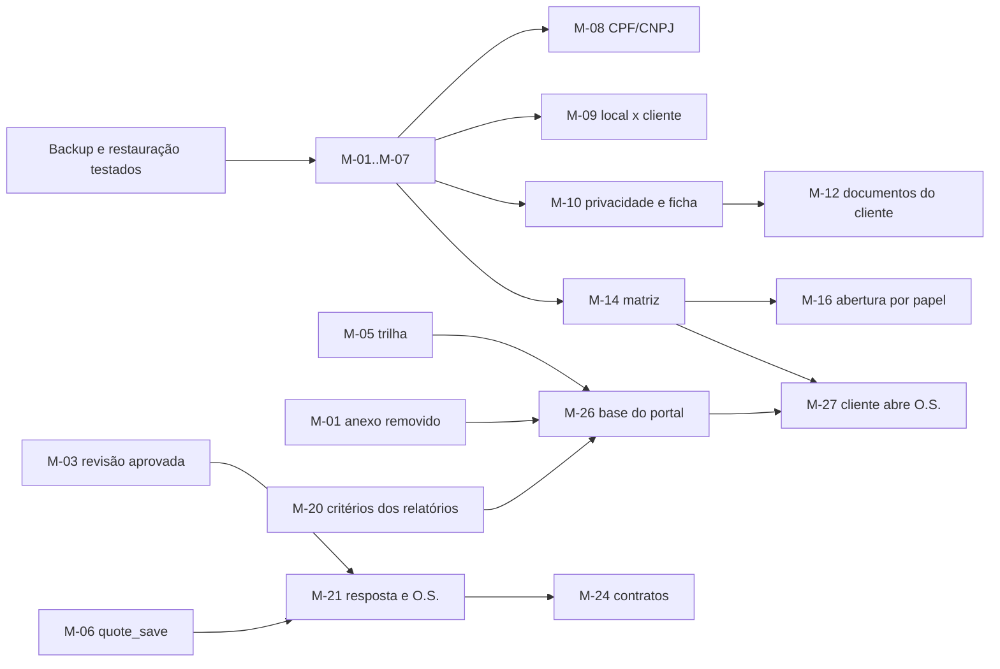

# 03 — Arquitetura e modelo de dados

> Propósito: propor a evolução do banco e da arquitetura sobre o stack atual, com migrações aditivas em ordem, o desenho seguro do portal do cliente, as opções de `.docx`, o backup antes de migrar e o deploy por fase. Data: 03/11/2026.

Evidências do estado atual: `01-auditoria-plataforma-atual.md` (abreviações de migração como `0400` em `01` §1). Itens que usam cada migração: `05-backlog-priorizado.md`. Regras de estado e acesso: `04-fluxos-e-permissoes.md`.

## 1. Princípios

1. **Sem trocar o stack.** Next.js 16 + Supabase (Postgres, Auth, Storage) + PDF por Chromium ou Gotenberg. Antes de escrever código, ler `node_modules/next/dist/docs/` (aviso do `AGENTS.md`).
2. **Não renomear tabelas para casar com os nomes do V4.** `service_requests` continua sendo a O.S., `request_events` a trilha, `sites` os locais. O mapa está na seção 2.
3. **Migração só aditiva**, em arquivo novo (`supabase/migrations/2026MMDDhhmmss_<nome>.sql`). Nunca editar migração aplicada.
4. **Comportamento atual preservado por padrão.** Regra nova que muda o fluxo entra desligada (opção em `company_settings`) até a decisão correspondente em `06-decisoes-pendentes.md`.
5. **Autorização no banco.** RLS e RPC `security definer` com `search_path=''` continuam sendo a fronteira. A tela só esconde o que o banco já nega.
6. **Sem dependência nova sem aprovação do Davi** (regra do `docs/14-plano-entrega-custo-zero.md` e das instruções do projeto). Onde a evolução pede biblioteca, este documento lista as opções.
7. **Fonte única do diário.** `work_entries` continua sendo o registro de execução que alimenta O.S., agenda, diário e relatórios. Nenhuma tabela "diário" materializada.

## 2. Modelo atual × proposto

Entidades mínimas do V4 (seção "Entidades mínimas") adaptadas ao que existe.

| Entidade V4 | Hoje | Proposta | Migração |
|---|---|---|---|
| `clients` | `clients` | Manter. Acrescentar `document_digits` (só dígitos, único) e documentos e fotos cadastrais | M-08, M-12 |
| `sites` | `sites` | Manter. Acrescentar orientações de acesso, horário, responsável Megagyn e responsável do cliente | M-11 |
| `areas` | `site_areas` | Manter | — |
| `collaborators` | `profiles` (só nome, e-mail, telefone, papel) | Nova `collaborator_profiles` 1:1 com `profiles` e `collaborator_documents`. Dados pessoais **fora** de `profiles`, que hoje é lido por toda a equipe | M-10 |
| `users` | `auth.users` + `profiles` | Manter | — |
| `site_memberships` | `site_memberships` (equipe); `client_contact_sites` (cliente) | Manter os dois. `client_contact_sites` ganha `ended_at` e trilha, em vez de DELETE físico | M-05 |
| `role_permissions` / `permission_overrides` | Não existe; regras fixas em RPC e políticas | Novas, com seed igual ao comportamento atual | M-14 |
| `work_orders` | `service_requests` | Manter o nome. Já tem número único, cliente/local, origem, canal, solicitante, situação, prioridade | M-16, M-17, M-19 |
| `work_order_events` | `request_events` (imutável) | Manter | — |
| `work_entries` / `service_updates` | `work_entries` + `work_entry_participants` | Manter como fonte única | — |
| `attachments` | `attachments` + `attachment_links` | Manter. Anexo removido fora do alcance; novos valores de entidade e papel | M-01, M-10, M-12, M-22 |
| `tasks`, `task_assignments` | `tasks`, `task_assignments`, `task_occurrences` | Manter o modelo com ocorrência por local. Corrigir o cancelamento; resultado e fotos ao finalizar | M-02, M-18 |
| Atividade avulsa | `work_entries` sem O.S. nem ocorrência | Manter | — |
| `quotes`, `quote_revisions` | `quotes`, `quote_items`, `quote_versions` | Manter. Aprovação da revisão enviada, guarda de situação, salvamento idempotente, regras de emissão | M-03, M-06, M-23 |
| `quote_files` | Fotos por `attachment_links` (entidade `quote`) | Acrescentar PDF anexo, ordem e escolha do que entra no PDF | M-22 |
| `quote_responses` | Texto livre (`accepted_note`, `status_reason`) | Nova, imutável | M-21 |
| `quote_work_order_links` | Não existe (só `sites.quote_id`) | Nova, com idempotência | M-21 |
| `contract_templates`, `contract_revisions`, `contracts`, `contract_files` | Não existe | Novas, mais `contract_template_versions`, `contract_work_orders` e `contract_acceptances` | M-24 |
| `report_runs` / `report_snapshots` | `monthly_closings`, `closing_versions`, `report_artifacts`, `report_publications` | Manter. Critérios, corte e chave de idempotência nos relatórios que não são fechamento | M-20 |
| `audit_events` | `audit_events` (imutável) | Manter. Completar gatilhos e registrar ações do Auth com o ator real | M-05 |
| `system_settings` | `company_settings` + 7 catálogos | Manter. Opções novas (foto inicial, portal) entram aqui | M-16, M-26 |
| `field_definitions` / `field_options` | Não existe | Novas, só para os campos aprovados | M-25 |
| `expenses`, `expense_allocations`, `reimbursements`, comprovantes, trilha | Existem (`expense_reviews` imutável, bucket `receipts`) | Preservar. Pagamentos de reembolso em linhas próprias; anulação só se decidido | M-04, M-28 |

Regras do V4 que o modelo já cumpre: IDs internos estáveis (UUID); CPF, CNPJ, e-mail e nome não são chave; colaborador bloqueado mantém autoria (FK `on delete restrict`); O.S. não aceita local de outro cliente (FK composta `0300:52`).

## 3. Regras para todas as migrações

| Regra | Por quê | Como |
|---|---|---|
| Arquivo novo, nunca editar o aplicado | O Supabase registra o que já rodou | `supabase/migrations/<data>_<nome>.sql` |
| `ALTER TYPE … ADD VALUE` em arquivo separado do primeiro uso | O valor novo não pode ser usado na mesma transação | Já feito assim em `1000`/`1100` |
| **Mudar parâmetros de RPC cria sobrecarga** | `CREATE OR REPLACE` com parâmetro a mais cria uma segunda função; o PostgREST passa a responder "could not choose the best candidate" | Parâmetro novo sempre com `DEFAULT`, para o app em produção continuar chamando; `DROP FUNCTION` da assinatura antiga **no mesmo arquivo** (substitui código, não apaga dados); ou função com nome novo |
| **Constraint nova sobre dados existentes** | Linha antiga inválida derruba a migração ou fica escondida | `ADD CONSTRAINT … NOT VALID` → consulta de diagnóstico mostrada ao Davi → correção com OK → `VALIDATE CONSTRAINT` |
| Índice único sobre dados existentes | Índice não aceita `NOT VALID` | Consulta de duplicatas primeiro; se houver, a migração para e volta para decisão |
| Tipos do banco | O TypeScript usa `src/server/db/database.types.ts` | `npm run db:types` depois de cada migração, no mesmo PR |
| Toda política nova tem teste | RLS errada vaza dados em silêncio | Caso positivo e negativo em `tests/db/`; teste "todas as tabelas públicas têm RLS ligada" segue verde |
| View com RLS | Por padrão a view roda com o dono e ignora a RLS de quem consulta | Usar `security_invoker = true`, ou filtro explícito por `auth.uid()` numa função `security definer` revisada |
| Backup antes de migração de risco | Volta possível se a migração destruir dado | Seção 8 |
| Migração em produção | Regra do projeto | Mostrar a SQL e o impacto esperado e esperar o OK do Davi |

## 4. Migrações em ordem

Colunas: objetivo e conteúdo · risco · compatibilidade com o app em produção · rollback · teste. A coluna "Origem" remete às propostas M1–M18 da auditoria de dados.

### 4.1 Fase 0 — correções e proteção

| Id | Objetivo e conteúdo | Risco | Compatibilidade | Rollback | Teste | Origem |
|---|---|---|---|---|---|---|
| M-01 | **Foto removida fora do alcance (A-02).** Recriar `attachments_select` com `and (revoked_at is null or public.is_admin())`. Na rota `src/app/api/files/[id]/route.ts` (código): 404 para anexo removido de quem não é admin; `Cache-Control: private, no-store` (A-28) | Baixo. As telas do campo deixam de mostrar a foto removida, que é o comportamento pedido em `docs/02 R-20` | Total | Recriar a política de `1400:438-444` | `tests/db/attachment-revoke.test.ts` + "funcionário não lê anexo removido"; `tests/e2e/fotos.spec.ts` + "link direto da foto removida responde 404" | M15 |
| M-02 | **Tarefa não fica presa em cancelada (A-05).** `tasks.cancelled_at`, `cancelled_by`, `cancel_reason`; `task_cancel` preenche; `refresh_task_status` deriva o cancelamento de `cancelled_at`; "todas não realizadas, nenhuma concluída" vira `planejada` (aguarda remarcação), sem valor novo de enum. Correção de dados: tarefas `cancelada` com alguma ocorrência `cancelada` foram canceladas de verdade (preencher `cancelled_at` pela trilha); as que só têm `nao_realizada` estão presas e são recalculadas | Baixo/Médio: muda a situação exibida de tarefas antigas | Assinaturas iguais | Função anterior (`0500:6-27`); colunas ficam sem uso | `tests/db/work-and-tasks.test.ts` + "tarefa de um local não realizada e remarcada volta a planejada e aceita novo local"; + "cancelamento explícito continua cancelado" | M16 |
| M-03 | **Aprovar a revisão enviada; guarda de situação (A-03, A-16).** `quotes.approved_version_no`; em `quote_transition('aprovar')`, copiar o snapshot da última versão enviada e ignorar `p_snapshot`; snapshot passa a guardar os ids de logo e assinatura usados; gatilho `guard_quote_status` igual ao da O.S. (`0300:64-74`). No app: tirar `"aprovar"` de `FREEZES` (`quotes.ts:182`) e gerar o PDF da versão aprovada ou da última enviada | Médio. Aprovações antigas já recongeladas não são reescritas; o diagnóstico lista quais têm v(n) diferente de v(n-1) | Mesma assinatura | Função de `1300:134-272`; `drop trigger` | `tests/db/quotes.test.ts` + "aprovação aponta a versão enviada mesmo após alterar o cliente"; + "situação não muda por atualização direta"; `src/domain/quote-snapshot.test.ts` + logo congelado | M8 (parte) |
| M-04 | **Proteção do financeiro (A-08, A-22).** `reimbursement_payments` imutável (valor, data, forma, observação, autor, `client_request_id` único por autor); `amount_paid_cents` passa a ser soma por gatilho; RPC de pagamento ganha `p_client_request_id` com `DEFAULT`, e a assinatura antiga sai no mesmo arquivo; uma linha "saldo migrado" por reembolso com valor pago, sem mudar totais; `settlement_notes` fica como histórico. `expense_save` confere que a O.S. ou ocorrência ligada é de local do rateio com acesso | Médio: mexe em valores. Diagnóstico antes e depois: soma paga por reembolso igual | Parâmetro novo com `DEFAULT` | Função anterior; tabela fica; volta a gravar `amount_paid_cents` direto | `tests/db/expenses.test.ts` + "pagamento repetido com a mesma chave não duplica"; + "migração preserva o total pago"; + "encarregado não liga compra a O.S. de local sem acesso" | M11 (parte) |
| M-05 | **Trilha administrativa (A-09).** Gatilhos de auditoria em `client_contact_sites`, `site_areas`, catálogos, `quote_items`, `attachment_links`, `request_assignments`, `task_assignments`; `client_contact_sites.ended_at` e encerramento com data no lugar do DELETE; RPC `audit_admin_action(entity, id, action, reason)`, só admin, ator = `auth.uid()`, chamada nas ações do Auth (criar, convidar, bloquear, reativar, senha provisória) | Baixo: volume de linhas | Aditivo | `drop trigger` e `drop function`; `ended_at` fica | `tests/db/audit-trail.test.ts` (novo): "criar usuário grava o ator real"; "encerrar vínculo do responsável do cliente fica na trilha" | M12 |
| M-06 | **Orçamento salvo uma vez (A-07).** `quotes.client_request_id` com índice único parcial por autor; RPC `quote_save(p_client_request_id, p_quote_id, p_header, p_items, p_expected_updated_at)` que trava a linha, troca os itens numa transação e devolve o mesmo orçamento no reenvio | Médio | Função nova; a ação troca no mesmo PR | Volta a ação anterior; função fica sem uso | `tests/db/quotes.test.ts` + "reenvio com a mesma chave não cria outro orçamento"; + "dois salvamentos simultâneos não duplicam itens" | M8 (parte) |
| M-07 | **Uma obra por orçamento (A-13).** Diagnóstico `select quote_id, count(*) from public.sites where quote_id is not null group by quote_id having count(*) > 1`; vazio → índice único parcial em `sites(quote_id)`. A ação trata `unique_violation` devolvendo a obra existente | Baixo | Aditivo | `drop index` | `tests/db/quotes.test.ts` + "criar obra duas vezes devolve a mesma" | B4 da auditoria |

### 4.2 Fase 1 — cadastros, locais e permissões

| Id | Objetivo e conteúdo | Risco | Compatibilidade | Rollback | Teste | Origem |
|---|---|---|---|---|---|---|
| M-08 | **CPF/CNPJ único (A-17).** `clients.document_digits` gerada; CHECK de 11 ou 14 dígitos por tipo, `NOT VALID` → diagnóstico → `VALIDATE`; duplicatas → índice único parcial `where document_digits <> ''` | Baixo/Médio: duplicata existente trava o índice; a Megagyn decide qual fica | Aditivo; a tela mostra "CPF/CNPJ já cadastrado" | `drop index`, `drop constraint` | `tests/db/clients.test.ts` (novo): "mesmo CNPJ com e sem pontuação é recusado" | M2 |
| M-09 | **Local pertence ao cliente (A-18).** FKs compostas `(site_id, client_id) → sites(id, client_id)` em `quotes`, `monthly_closings`, `billing_rules`, `NOT VALID` → diagnóstico → `VALIDATE`. No app: o fechamento valida antes de inserir | Baixo | Aditivo | `drop constraint` | `tests/db/closings.test.ts` + "fechamento com local de outro cliente não deixa linha órfã"; `quotes.test.ts` + "orçamento com local de outro cliente é recusado pelo banco" | M17 |
| M-10 | **Privacidade dos perfis e ficha do colaborador (A-24, T03).** Etapa 1: a equipe lê de `profiles` só nome, papel e situação (função ou view revisada); e-mail e telefone só para admin e a própria pessoa; colunas internas de clientes e locais fora do alcance da equipe. Antes, levantar todas as consultas que fazem embed de `profiles`. Etapa 2, em arquivos próprios: valores novos nos enums `attachment_entity` (`profile`) e `attachment_bucket` (bucket privado de cadastros, criado também em `storage.buckets`, sem política de Storage); `private.link_attachments` (`1400:21-70`) passa a aceitar a combinação entidade × bucket nova; `collaborator_profiles` 1:1 (`cpf_digits` com CHECK e único, `rg`, órgão emissor, endereço, `job_title`, `photo_attachment_id`); `collaborator_documents`; RLS só admin e leitura da própria linha; `audit_row` mascara CPF e RG | Médio: LGPD; a etapa 1 pode quebrar telas que leem perfis | Etapa 1 exige E2E completo antes do merge | Recriar `profiles_select` de `0100:431-432`; tabelas novas ficam sem uso | `tests/db/collaborators.test.ts` (novo): "funcionário não lê CPF nem telefone de colega"; "admin lê a ficha"; "trilha não mostra CPF em claro" | M1 |
| M-11 | **Local: acesso e responsáveis (T05).** `sites.access_hours`, `access_instructions`, `responsible_profile_id`, `client_responsible_contact_id`, com FK composta para contato do mesmo cliente (`UNIQUE (id, client_id)` em `client_contacts`) | Baixo | Aditivo | `drop column` | `tests/db/clients.test.ts` + "responsável do local precisa ser contato do mesmo cliente" | M3 |
| M-12 | **Documentos e fotos do cliente (T02).** Arquivo separado: `attachment_entity` ganha `client`. Depois: vínculos com papel de documento ou foto cadastral, categoria e visibilidade (padrão interna), no mesmo bucket privado de cadastros da M-10; só admin lê | Baixo/Médio | Aditivo | Valores de enum ficam; políticas saem | `tests/db/client-documents.test.ts` (novo): "funcionário com acesso ao local não baixa documento do cliente" | — |
| M-13 | **Desligamento com pendências (A-12).** Função de leitura `profile_open_items(p_profile)` para a prévia; RPC `profile_deactivate(p_profile, p_reason, p_reassign_to default null)`: encerra vínculos (`active_to` = hoje), transfere ou lista atribuições abertas em O.S. e tarefas, notifica o admin; autoria intacta | Médio: mexe na agenda | Funções novas | Volta a ação anterior | `tests/db/requests.test.ts` + "desativar com transferência move as atribuições abertas e mantém o autor dos registros" | M14 |
| M-14 | **Matriz de permissões (T04).** `role_permissions(role, module, action, allowed)`; `permission_overrides(profile_id, module, action, site_id, allowed, reason, granted_by, expires_at)`; `private.can(module, action, site)`. Seed igual à matriz atual (`04-fluxos-e-permissoes.md` §4.1). Piso fixo: validar, cancelar, reabrir, configurações e gerenciar acessos exigem admin, salvo exceção explícita e auditada; nada dá acesso a outro cliente; ninguém altera a própria permissão. As RPCs passam a consultar `can` além do piso, uma por PR | Médio/Alto: configuração errada abre acesso | Seed = comportamento atual: nada muda no dia | RPCs voltam a ignorar `can`; tabelas ficam | `tests/db/permissions.test.ts` (novo): "seed reproduz a matriz atual" (tabela de casos); "exceção não contorna o piso"; "usuário não altera a própria permissão"; "alteração fica na trilha" | M5 |
| M-15 | **Aviso de versão desatualizada (A-25).** `p_expected_version` com `DEFAULT null` em `request_update` (assinatura antiga sai no mesmo arquivo); `updated_at` esperado em clientes e locais (na ação) e no orçamento (M-06) | Médio | Nulo = sem checagem; a tela passa a enviar o valor lido | Função anterior | `tests/db/requests.test.ts` + "edição com versão antiga é recusada" | M13 |

### 4.3 Fase 2 — O.S., tarefas e campo

| Id | Objetivo e conteúdo | Risco | Compatibilidade | Rollback | Teste | Origem |
|---|---|---|---|---|---|---|
| M-16 | **Abertura por papel e foto inicial configurável (DP-02, DP-06).** `request_open` aceita encarregado e funcionário quando `private.can('os','criar', site)` (depende da M-14); `company_settings.require_initial_photo boolean default false`; ligada, a RPC exige ao menos 1 foto inicial; origem `cliente_portal` segue bloqueada até a M-27 | Médio | Padrões preservam o comportamento atual | Opção desligada; função anterior | `tests/db/requests.test.ts` + "com foto obrigatória ligada, abrir sem foto é recusado"; + "encarregado com permissão abre O.S. só no local autorizado" | M6 |
| M-17 | **Pendência sem data (DP-07).** `p_no_return_justification text default null` em `request_report_pending`; data nula aceita com justificativa, gravada no payload; alerta derivado. Assinatura antiga sai no mesmo arquivo | Baixo | Parâmetro com `DEFAULT` | Função anterior (`0400:554-613`) | `tests/db/requests.test.ts` + "sem previsão e sem justificativa é recusado; com justificativa grava e alerta" | M7 |
| M-18 | **Resultado ao finalizar tarefa (A-14).** `task_occurrence_finish` ganha `p_photo_ids uuid[] default '{}'` (entidade `task_occurrence`, papel resultado); descrição e foto obrigatórias só se DP-05 decidir. Assinatura antiga sai | Baixo | Parâmetro com `DEFAULT` | Função anterior | `tests/db/work-and-tasks.test.ts` + "finalizar grava a observação e as fotos" | — |
| M-19 | **Programação, reabertura e cancelamento (A-19, DP-04).** `request_schedule` exige motivo quando prazo ou prioridade mudam (parâmetro com `DEFAULT`, se ainda não houver); reabertura e cancelamento só mudam se DP-04 mudar o comportamento atual | Baixo | Parâmetro com `DEFAULT` | Função anterior | `tests/db/requests.test.ts` + "reprogramar mudando o prazo sem motivo é recusado" | B11 da auditoria |

### 4.4 Fase 3 — diário, PDFs e CSV

| Id | Objetivo e conteúdo | Risco | Compatibilidade | Rollback | Teste | Origem |
|---|---|---|---|---|---|---|
| M-20 | **Critérios, corte e idempotência dos relatórios (A-23).** `report_artifacts.criteria jsonb`, `cutoff_at`, `client_request_id` único por solicitante; `closing_version_create` com chave de idempotência (`DEFAULT null`; assinatura antiga sai). Nos relatórios que não são fechamento, guardar critérios e hash do conteúdo, não o payload inteiro, por causa do limite de 500 MB do Supabase Free | Baixo | Aditivo | Colunas ficam; função anterior | `tests/db/report-queue.test.ts` + "pedido repetido com a mesma chave devolve o mesmo PDF"; `closings.test.ts` + "emitir duas vezes com a mesma chave cria uma versão" | M10 |

A pendência no diário (A-10) não precisa de migração: o diário passa a projetar os eventos de pendência do dia a partir de `request_events`, sem criar lançamento e sem dupla contagem (B-45).

### 4.5 Fase 4 — comercial

| Id | Objetivo e conteúdo | Risco | Compatibilidade | Rollback | Teste | Origem |
|---|---|---|---|---|---|---|
| M-21 | **Resposta e vínculo com O.S. (T10).** `quote_responses` imutável (decisão, `version_no`, nome e contato de quem respondeu, canal, data, `evidence_attachment_id`, `recorded_by`); `UNIQUE (id, client_id)` em `service_requests` (o `id` já é único, então não há diagnóstico); `quote_work_order_links(quote_id, version_no, service_request_id, client_id)` com FK composta para a O.S. do mesmo cliente e uma O.S. por orçamento na primeira versão; RPC `quote_create_or_link_work_order(p_quote_id, p_client_request_id, p_existing_request_id default null)`: só orçamento aprovado; copia cliente, local e escopo; repetir devolve a mesma O.S. Se a origem "orçamento" for aprovada, o valor novo do enum vai em arquivo separado | Médio | Aditivo | Tabelas ficam; função sai | `tests/db/quote-response.test.ts` (novo): "resposta aponta a revisão exata"; "gerar O.S. duas vezes devolve a mesma"; "vincular O.S. de outro cliente é recusado pelo banco" | M8 (parte) |
| M-22 | **Anexos PDF e ordem das fotos (T10).** Bucket `quotes` aceita `application/pdf` (lista do bucket e CHECK de anexo: constraint nova `NOT VALID` → `VALIDATE`); valor `anexo` em `evidence_role` (arquivo separado); `attachment_links.include_in_pdf boolean default true`; RPC `quote_reorder_photos(p_quote_id, p_attachment_ids)` só em rascunho | Médio | Aditivo | Lista de MIME anterior; função sai | `tests/db/quotes.test.ts` + "PDF anexado só em rascunho"; + "reordenar muda a ordem no snapshot" | M8 (parte) |
| M-23 | **Regras de emissão (DP-08, DP-09).** `quote_transition('enviar')` exige descrição, período, pagamento, garantia e data; aceita valor total ≥ 0 com um item de valor global; CHECK de subtotal passa de `> 0` para `>= 0` (afrouxar não exige diagnóstico). Vale só para novos envios | Médio | Orçamentos já enviados não são revalidados | Função anterior; CHECK anterior | `tests/db/quotes.test.ts` + "emissão sem garantia é recusada e o rascunho salva"; + "valor total sem itens por ambiente é emitido" | M8 (parte) |
| M-24 | **Contratos (T11).** `contract_templates`; `contract_template_versions` (imutável: corpo, variáveis); `contracts` (número `CON-AAAA-NNNN` por `private.number_sequences`, cliente, orçamento opcional, situação, datas, `client_request_id`); `contract_work_orders(contract_id, service_request_id, client_id)` com FK composta para `service_requests(id, client_id)` (criada na M-21); `contract_revisions` (imutável: texto final, variáveis usadas, versão do modelo); `contract_files` (PDF e `.docx` ligados a `report_artifacts`; valores novos de `kind` em arquivo separado); `contract_acceptances`; guarda de situação; RLS só admin | Médio | Aditivo | Tabelas ficam sem uso | `tests/db/contracts.test.ts` (novo): "O.S. de outro cliente é recusada pelo banco"; "revisão emitida não muda"; "alterar o modelo não muda contrato emitido" | M9 |

### 4.6 Fase 5 — configurações avançadas

| Id | Objetivo e conteúdo | Risco | Compatibilidade | Rollback | Teste | Origem |
|---|---|---|---|---|---|---|
| M-25 | **Campos configuráveis (DP-10).** `field_definitions(entity, key, label, help_text, required_stage, visible_roles, is_core, is_active)` e `field_options`; `is_core` impede desligar campo essencial; a obrigatoriedade configurada nunca afrouxa a regra da RPC; alterações auditadas. Só nos campos aprovados | Médio | Sem configuração = comportamento atual | Tabelas ficam sem uso | `tests/db/field-settings.test.ts` (novo): "campo essencial não desliga"; "inativar campo preserva valores"; "configuração não libera acesso" | M18 |

### 4.7 Fase 6 — portal do cliente (condicional a DP-01)

| Id | Objetivo e conteúdo | Risco | Compatibilidade | Rollback | Teste | Origem |
|---|---|---|---|---|---|---|
| M-26 | **Base segura do acesso do cliente, desligada.** Desenho na seção 6 | **Alto** | `portal_enabled = false`; nenhuma rota do cliente responde | Desligar a opção; políticas e funções saem | `tests/db/client-isolation.test.ts` (novo), seção 6.6 | M4 |
| M-27 | **O.S., comentário e foto pelo cliente.** `request_open` aceita cliente com `client_site_access(site, 'abrir')` e origem `cliente_portal`; comentário do cliente sempre com `is_internal = false`; a rota de upload aceita cliente para evidência da própria O.S., com `visibility = 'client'` | Alto | Só com o portal ligado | Função anterior | `client-isolation.test.ts` + "cliente abre O.S. só na unidade autorizada"; + "comentário do cliente nunca é interno" | M4, M6 |

### 4.8 Opcional

| Id | Objetivo e conteúdo | Condição |
|---|---|---|
| M-28 | Anulação de despesa: `expense_review_status` ganha `anulado` (arquivo separado) e RPC `expense_void(motivo)`; totais e CSV excluem anuladas | Só se DP-11 pedir; o financeiro fica preservado sem expansão |

## 5. Ordem de execução e dependências

O portal (M-26, M-27) vem por último porque depende da matriz (M-14), da trilha dos vínculos do cliente (M-05), do anexo removido fora do alcance (M-01) e dos relatórios com critérios guardados (M-20), além da decisão DP-01.

## 6. Desenho seguro do portal do cliente

### 6.1 O que não fazer

Não incluir o papel `client` em `has_site_access` (`0100:215-229`). A função alimenta cerca de 12 políticas que devolvem linhas inteiras, com comentários e eventos internos, horas, anotações internas e de cobrança, fotos removidas e lançamentos não visíveis ao cliente (A-01).

### 6.2 Função de acesso separada

`public.client_site_access(p_site uuid, p_action text) returns boolean`, `security definer`, `search_path=''`, `stable`. Devolve verdadeiro só quando, ao mesmo tempo:

- `company_settings.portal_enabled` está ligado;
- o perfil de `auth.uid()` está ativo e tem papel `client`;
- existe `client_contacts` ativo, não anonimizado, com `user_id = auth.uid()`;
- existe `client_contact_sites` ativo (sem `ended_at`) para `p_site`, com a permissão da ação (`can_open_requests` para abrir, `can_view_reports` para relatórios) e a permissão da matriz (M-14) para o módulo.

### 6.3 Leitura: dados internos fora do alcance

Uma política de SELECT na tabela base libera **todas as colunas** das linhas permitidas pela API. Por isso:

| Tabela | Colunas internas | Como o cliente lê |
|---|---|---|
| `service_requests` | Poucas | Política só de SELECT com `client_site_access(site_id, 'ver') and not is_internal` |
| `request_events` | `is_internal`, `payload` com nomes internos | Função de leitura com lista branca de tipos de evento e de campos do payload |
| `request_comments` | `is_internal` | Política só de SELECT com `not is_internal` e O.S. visível |
| `work_entries` | `hours_worked`, `submitted_payload`, `client_visible` | Função ou view com filtro explícito: só `client_visible`, sem horas e sem original |
| `attachments` | `storage_key`, `original_name`, `uploaded_by` | Sem política para o cliente; a rota de arquivo decide (6.4) |
| `clients`, `sites` | `notes_internal`, `billing_info` | Função ou view com filtro explícito, só colunas públicas |
| `report_publications` | — | Só publicações do próprio cliente, não revogadas |
| Despesas, reembolsos, jornadas, regras de cobrança, perfis de terceiros, fichas de colaborador, catálogos financeiros, configurações | Tudo | Nenhuma política: negado por omissão |

Escrita do cliente só por RPC (M-27). Nenhuma política de INSERT, UPDATE ou DELETE para o papel `client`.

### 6.4 Arquivos e link direto

Em `GET /api/files/[id]`, para o papel `client`, a rota chama `client_can_see_attachment(p_id)`: exige `visibility = 'client'`, `revoked_at is null` e vínculo com registro visível ao cliente (O.S. não interna, lançamento `client_visible`). Sem isso, 404 igual a inexistente. Resposta com `Cache-Control: private, no-store`.

### 6.5 PDF e CSV gerados com `service_role`

Os PDFs são montados com `service_role` (`src/server/reports/jobs.ts:15`, `:34`), sem RLS. Para o cliente:

1. **Autorização no pedido:** a ação confere `client_site_access(site, 'exportar')` e uma lista fechada de tipos (diário para o cliente, fechamento publicado, O.S. individual na versão do cliente). Parâmetros como `site_id` nunca são aceitos sem recheque.
2. **Conteúdo filtrado:** o builder usa só o payload do cliente (lista branca campo a campo, como `docs/02 R-99`); fechamento publicado sai do snapshot congelado.
3. **Download:** `report_artifacts` com `audience = 'client'`; a rota de download confere que o pedido é do próprio usuário ou que a publicação é do cliente dele.
4. **CSV:** mesma regra; consulta pela função de leitura do cliente, nunca pela consulta da administração.

### 6.6 Testes de isolamento (antes de ligar)

Arquivo `tests/db/client-isolation.test.ts`, com dados fictícios: Cliente Exemplo Ltda. (Unidade Centro e Unidade Norte) e Cliente Outro Ltda. (Unidade Sul); usuária "Ana Exemplo" com acesso só à Unidade Centro.

| Caso | Esperado |
|---|---|
| Para cada tabela pública, `select *` da Ana sem filtro | Só linhas da Unidade Centro onde há política; 0 nas demais |
| O.S., evento, comentário e foto da Unidade Norte por id | 0 linhas; rota de arquivo 404 |
| Comentário interno, evento interno e lançamento não visível da Unidade Centro | Não aparecem |
| Horas, despesas, reembolsos, fichas de colaborador | 0 linhas |
| Foto removida da Unidade Centro | 404 |
| PDF e CSV da Unidade Norte pedidos por parâmetro | 403 |
| `has_site_access` com a Ana | Continua `false` (guarda de regressão) |
| Portal desligado | Todas as funções do cliente devolvem `false` |
| Vínculo encerrado durante a sessão | Acesso cai na próxima consulta |

E2E correspondente: `tests/e2e/portal-cliente.spec.ts` (cenários 2 e 17 do V4 §9; CA-1).

### 6.7 Ativação

1. Base (M-26) publicada com `portal_enabled = false`.
2. Bateria 6.6 verde e revisão de segurança independente (B-67).
3. DP-01 decidida pela Megagyn.
4. Liga para um cliente piloto (B-71). Rollback: desligar a opção.

## 7. Geração de `.docx`

O contrato precisa sair em PDF e em Word com o mesmo conteúdo e a mesma revisão (Descrição p. 2; GPT p. 15, p. 19). Hoje não há biblioteca para isso (`package.json`). **Qualquer biblioteca nova só entra com aprovação do Davi.**

| Opção | Como | A favor | Contra | Dependência |
|---|---|---|---|---|
| A. Biblioteca de geração (ex.: `docx`) | O mesmo conteúdo estruturado da revisão gera o HTML do PDF e o `.docx` | Roda na Vercel e na Oracle; sem serviço externo | Biblioteca nova; aparência do Word e do PDF feitas por caminhos diferentes | 1 pacote npm (licença a conferir antes de aprovar) |
| B. Modelo `.docx` preenchido (ex.: `docxtemplater` + `pizzip`) | A Megagyn entrega um `.docx` com marcadores; o sistema preenche | Documento com a cara que eles já usam | 2 pacotes; o PDF precisa sair do mesmo texto por outro caminho, com risco de divergência | 2 pacotes npm |
| C. LibreOffice no servidor | Converter HTML em `.docx` dentro do container da Oracle | Um único HTML gera os dois | Não roda na Vercel; imagem maior; conversão de HTML para Word perde formatação. O Gotenberg só devolve PDF | Infraestrutura, sem npm |
| D. Montar o `.docx` à mão | Código próprio para o ZIP e o XML do Word | Nenhuma dependência | Formato complexo; risco de arquivo que o Word recusa; manutenção alta | Nenhuma |
| E. HTML com extensão `.doc` | O Word abre HTML | Trivial | Não é `.docx`; formatação frágil; aviso ao abrir | Nenhuma |

**Proposta:** opção A, se aprovada. Para garantir o mesmo conteúdo:

- a revisão guarda o texto final em estrutura simples (título, parágrafo, lista, negrito), sem editor rico de terceiros;
- dois renderizadores do mesmo dado: HTML para o PDF e `.docx`;
- teste `src/domain/contract-render.test.ts` compara o texto normalizado dos dois com o texto da revisão;
- variáveis (`{{cliente.nome}}` e semelhantes) vêm de lista fechada; variável sem valor fica destacada na prévia e bloqueia a emissão.

O formato `.doc` antigo fica fora, salvo decisão contrária (DP-12).

Incorporar PDFs anexos ao fim do orçamento (GPT p. 14) também pede biblioteca de junção de PDF quando o renderizador é o Chromium. Padrão proposto: anexos separados, baixados à parte, até haver aprovação (B-52).

## 8. Backup e teste de restauração antes de migrar

Migrações de risco: M-02 (recálculo de tarefas), M-03, M-04 (valores), M-07, M-08, M-09, M-10, M-14, M-24, M-26 e M-27.

Antes de cada uma:

1. Base local limpa: `npm run db:reset` e `npm run seed`, rodados pelo Davi (A-31; apaga a base local).
2. Backup: `npm run backup` (ou o workflow diário, quando ligado).
3. Restauração em base descartável: `npm run restore:test -- backups/<pasta>`. Esperado: contagens iguais e todos os arquivos conferidos (`docs/08-operacao.md` §5). Nunca restaurar sobre a produção.
4. Migração aplicada primeiro no banco local e depois na homologação (B-79), com `npm run test:db` verde.
5. Consultas de diagnóstico rodadas na produção (somente leitura) e mostradas ao Davi com o impacto esperado.
6. Aplicação em produção com o OK do Davi (`supabase db push`).
7. Consultas de conferência depois (contagens, somas, constraints validadas).

## 9. Estratégia de deploy por fase

Fato que manda: todo merge na `main` publica sozinho na Vercel. O banco é atualizado à parte, com `supabase db push`.

| Regra | Como |
|---|---|
| Nada publica sem o Davi | Branch por assunto (`fix/…`, `feat/…`), PR, merge feito pelo Davi |
| Banco antes do app | Migração aditiva aplicada antes do merge; o app em produção continua funcionando com o banco novo (parâmetros novos com `DEFAULT`) |
| Regra nova desligada | Opções em `company_settings` com padrão igual ao comportamento atual; liga depois da decisão |
| Verificação antes do PR | `npm run lint`, `npm run typecheck`, `npm test`, `npm run test:db`, `npm run build`, E2E contra `next start` (`docs/10-checklist-aceite.md`). O CI roda só lint, typecheck, unitários e build |
| Pré-visualização | Conferir se as variáveis de Preview da Vercel apontam para o banco de produção (não verificável daqui, B-80). Se apontarem, desligar a pré-visualização ou separar as variáveis |
| Rollback do app | Voltar ao deploy anterior no painel da Vercel; na Oracle, voltar ao commit anterior e subir o Compose |
| Rollback do banco | Coluna "Rollback" da seção 4; dado corrigido volta pelo backup do passo 8 |

| Fase | Como publicar |
|---|---|
| 0 | Um PR por bug, com teste que falha antes. Migrações M-01 a M-07 aplicadas uma a uma, cada uma com o seu PR |
| 1 | M-10 etapa 1 (privacidade) num PR isolado com E2E completo. Matriz (M-14) entra com seed igual ao atual e sem tela de edição; a tela vem em PR seguinte |
| 2 | Opções novas desligadas; ligar só depois de DP-02, DP-05, DP-06 e DP-07 |
| 3 | Relatórios novos convivem com os atuais; o fechamento mensal não muda |
| 4 | Contratos atrás de item de menu só para admin; `.docx` só depois da aprovação da biblioteca |
| 5 | Configurações novas sem efeito até haver registro em `field_definitions` |
| 6 | Portal publicado desligado; liga para um cliente piloto depois de B-66, B-67 e DP-01 |
| Operação | Troca para a Oracle (B-78) antes do uso comercial; Vercel e Render ficam 7 dias como retorno (plano 14, Task 12) |
