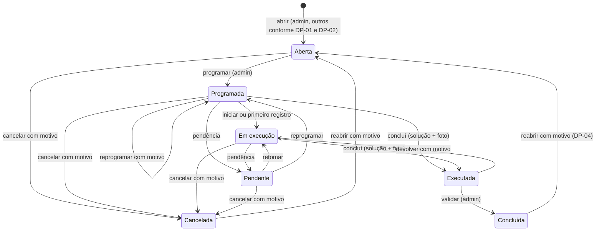
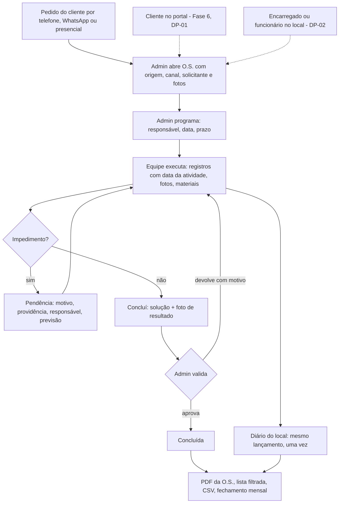
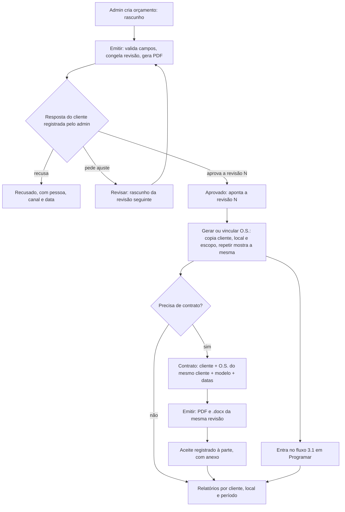

# 04 — Fluxos e permissões

> Propósito: descrever as máquinas de estado e a matriz de acesso, hoje e propostas, com quem executa cada passo, o que é validado, o que fica gravado e o que o cliente pode ver. Data: 03/11/2026.

Evidências: `01-auditoria-plataforma-atual.md`. Migrações citadas (M-xx): `03-arquitetura-e-modelo-de-dados.md`. Decisões (DP-xx): `06-decisoes-pendentes.md`.

Legenda dos papéis: **Admin** (administração da Megagyn), **Encarregado**, **Funcionário**, **Cliente** (responsável do cliente). Nas matrizes: **Sim**, **Não**, **L** (só locais com vínculo ativo), **Atr.** (só o que foi atribuído à pessoa), **Próp.** (só registros próprios). "Hoje → Proposta" quando muda.

## 1. Regras gerais

- Toda transição de estado passa por RPC no banco; a tela só mostra os botões que a RPC aceitaria (`REQUEST_ACTIONS`, `src/domain/request-status.ts:44-66`).
- Toda transição grava autor e instante (`clock_timestamp`), e motivo quando exigido.
- Prazo vencido é alerta, nunca estado (GPT p. 3, p. 5; `src/domain/request-status.ts:131-136`).
- Regra nova que muda o fluxo atual entra desligada até a decisão (DP-xx).

## 2. Máquinas de estado

### 2.1 Ordem de serviço

Estados atuais e propostos são os mesmos 7: Aberta, Programada, Em execução, Pendente, Executada, Concluída, Cancelada (`0300:4-6`; GPT p. 3). A situação só muda por RPC: o gatilho `guard_request_status` barra update direto.

| Transição | Quem executa hoje | Proposta | Validações | Evento gravado (`request_events`) |
|---|---|---|---|---|
| Nova → Aberta | Admin (`request_open`) | Admin sempre; encarregado e funcionário nos locais autorizados (DP-02); cliente nos próprios locais (DP-01) | Idempotente por `client_request_id`; cliente vem do local; solicitante obrigatório quando a origem é o cliente; setor do mesmo local; foto inicial opcional hoje, obrigatória se DP-06 | Abertura, com origem, canal, solicitante e fotos |
| Aberta, Programada ou Pendente → Programada | Admin (`request_schedule`) | Admin; encarregado "se autorizado" (matriz, M-14) | Ao menos 1 responsável com vínculo ativo no local; data obrigatória; motivo quando prazo ou prioridade mudam (hoje não exige, A-19) | `classificacao` ou `reprogramacao` |
| Programada → Em execução | Equipe com acesso ao local (`request_start`) ou automático no 1º registro | Equipe atribuída (DP-21) | — | Início |
| Programada ou Em execução → Pendente | Equipe com acesso (`request_report_pending`) | Igual | Motivo ativo, explicação, providência, responsável ativo, previsão de retorno ≥ hoje; sem data só com justificativa se DP-07 | `pendencia`, com payload completo |
| Pendente → Em execução | Equipe (`request_resume`) | Igual | — | Retomada; registros anteriores preservados |
| Programada ou Em execução → Executada | Equipe (`request_mark_executed`) | Igual | Solução e ao menos 1 foto de resultado com vínculo real (`1400:363-423`); cria um lançamento | Execução, ligada ao lançamento |
| Executada → Concluída | Admin (`request_validate`) | Admin; encarregado só se DP-03 autorizar | — | Validação |
| Executada → Em execução | Admin (`request_return`) | Igual | Motivo obrigatório | Devolução, com motivo |
| Aberta, Programada, Em execução ou Pendente → Cancelada | Admin (`request_cancel`) | Admin; cancelar a partir de Executada só se DP-04 decidir | Motivo obrigatório | Cancelamento, com motivo |
| Concluída ou Cancelada → Aberta | Admin (`request_reopen`) | Volta à etapa de programação (DP-04) | Motivo obrigatório; eventos anteriores ficam; `closed_at` é zerado (A-26) | Reabertura, com motivo |

Fluxo proposto (GPT p. 3, com as decisões padrão de `06-decisoes-pendentes.md`):

Agrupamento para relatório (GPT p. 3; Descrição p. 1): **Abertas** = Aberta + Programada; **Em andamento** = Em execução + Pendente + Executada; **Fechadas** = Concluída; **Canceladas** à parte. O cartão "O.S. em aberto" do painel conta tudo que não está encerrado (GPT p. 5): nome parecido, conjunto diferente. A tela deve dizer qual regra usa.

### 2.2 Tarefa

Hoje a tarefa tem uma ocorrência por local (`task_occurrences`), e a situação da tarefa é derivada das ocorrências por gatilho (`0500:6-36`).

| Transição da ocorrência | Quem executa | Validações hoje | Proposta | Registro |
|---|---|---|---|---|
| Prevista → Iniciada | Atribuído com acesso ao local (`task_occurrence_start`) ou automático no 1º registro | — | Igual | `audit_events` |
| Prevista ou Iniciada → Concluída | Atribuído com acesso (`task_occurrence_finish`) | Nenhuma: não pede resultado nem foto (A-14) | Observação e fotos (M-18); obrigatórias e com validação do admin só se DP-05 | `audit_events`; com M-18, vínculo de fotos |
| Prevista ou Iniciada → Não realizada | Atribuído com acesso (`task_occurrence_not_done`) ou admin pela agenda | Motivo obrigatório | Motivo e providência (GPT p. 16) | `audit_events` |
| Não realizada → Prevista | Admin (`task_occurrence_reschedule`) | Motivo obrigatório | Igual | `audit_events` |
| Prevista ou Iniciada → Cancelada | Admin (`task_cancel`) | Motivo obrigatório | Igual, com `cancelled_at` na tarefa (M-02) | `audit_events` |
| Desdobrar para outro local | Atribuído com acesso | Vínculo com o local novo | Igual | Ocorrência nova |

Situação da tarefa:

| Regra | Hoje | Proposta |
|---|---|---|
| Uma vez cancelada | Fica cancelada para sempre, mesmo remarcada (A-05) | Cancelada só com `cancelled_at` |
| Todas as ocorrências não realizadas | Vira cancelada | Fica planejada, aguardando remarcação |
| Alguma iniciada ou concluída | Em andamento | Igual |
| Todas terminais e ao menos uma concluída | Concluída | Igual |

Rótulos do caderno (GPT p. 16) aplicados na tela sem trocar os valores do banco: prevista = **Programada**, iniciada = **Em execução**, não realizada = **Pendente**, concluída = **Concluída**, cancelada = **Cancelada**. Concluir a tarefa não conclui a O.S. (GPT p. 16, p. 19; hoje já é assim).

### 2.3 Orçamento

Transições em `quote_transition`, só admin (`1300:134-272`). "Vencido" é derivado da validade, nunca gravado.

| Transição | Hoje | Proposta | Validações propostas | Registro |
|---|---|---|---|---|
| Rascunho → Enviado (emitido) | Exige ao menos 1 item e validade ≥ hoje; congela versão | Exige descrição, valor ≥ 0, período, pagamento, garantia e data; valor total sem itens por ambiente (DP-08; M-23) | Só para novos envios | Versão congelada em `quote_versions` |
| Enviado → Aprovado | Exige texto "quem aprovou e como" e data; bloqueado se vencido; **recongela os dados atuais** (A-03) | Aprova a revisão enviada (`approved_version_no`); resposta estruturada (M-21); vencido conforme DP-09 | Pessoa, canal, data e evidência opcional | `quote_responses` imutável |
| Enviado ou Vencido → Recusado | Motivo | Igual, com resposta estruturada | Pessoa, canal, data | `quote_responses` |
| Rascunho, Enviado ou Vencido → Cancelado | Motivo | Igual | — | Versão e trilha |
| Enviado ou Vencido → Rascunho (revisar) | Motivo; o reenvio cria a versão seguinte | Igual | — | Versão seguinte |
| Vencido → Enviado (renovar) | Nova validade; nova versão | Igual | — | Nova versão |
| Aprovado → gerar ou vincular O.S. | Não existe; só "criar obra" (A-13) | Ação idempotente: copia cliente, local e escopo; liga à revisão aprovada (M-21) | Só aprovado; O.S. do mesmo cliente | `quote_work_order_links` |
| Qualquer mudança de situação fora da RPC | Possível pela API (A-16) | Barrada por gatilho (M-03) | — | — |

### 2.4 Contrato (proposta; não existe hoje)

Estados formais não constam do caderno (lacuna L-16 da extração). Proposta mínima, a validar com DP-13 e DP-22:

| Transição | Quem | Validações | Registro |
|---|---|---|---|
| Novo → Rascunho | Admin | Cliente; ao menos 1 O.S. do mesmo cliente (FK composta, M-24); modelo e versão | `contracts` |
| Rascunho → Emitido | Admin | Datas obrigatórias, fim ≥ início; nenhuma variável sem valor; texto aprovado | `contract_revisions` imutável; PDF e `.docx` da mesma revisão |
| Emitido → Rascunho da revisão seguinte | Admin | Motivo | Revisão anterior preservada |
| Emitido → Aceite registrado | Admin | Data, responsável, anexo opcional; exportar não conta como aceite | `contract_acceptances` |
| Rascunho ou Emitido → Cancelado | Admin | Motivo | Trilha |

### 2.5 Fechamento mensal

| Transição | Quem | Hoje | Proposta |
|---|---|---|---|
| Prévia calculada | Admin | Calculada na hora, marcada "PRÉVIA" no PDF | Igual |
| Rascunho → Fechado (v1) | Admin (`closing_version_create`) | Versão imutável, com corte, critérios, cabeçalho e payload congelados | Igual, com chave de idempotência (M-20) |
| Fechado → vN | Admin | Motivo obrigatório da v2 em diante; `supersedes_version_id` | Igual |
| Registrar entrega ou revogar | Admin | `report_publications` (canal e observação) | Publicação para o cliente no portal só na Fase 6 (DP-01) |

Conjuntos do fechamento (herdadas, recebidas, concluídas no mês, não concluídas no corte, canceladas, reabertas) podem se sobrepor e não são somados (GPT p. 12; `src/domain/closing.ts:189-197`).

## 3. Mapas dos dois fluxos

### 3.1 Demanda direta → O.S. → execução → validação → PDF

### 3.2 Proposta comercial → aprovação → O.S. → contrato opcional → relatório

## 4. Quem pode o quê

### 4.1 Matriz atual × proposta, por módulo e ação

Hoje (do backend: RLS, RPC e rotas; `01` §6) → proposta padrão (GPT p. 4, com as decisões padrão de `06`). A matriz atual é o seed da M-14.

| Módulo | Ação | Admin | Encarregado | Funcionário | Cliente |
|---|---|---|---|---|---|
| Clientes e locais | Ver | Sim | L, linha inteira com campos internos → L, sem campos internos (A-24) | Igual ao encarregado | Não → próprio cliente e locais autorizados, só dados públicos (DP-01) |
| | Criar, editar, inativar | Sim | Não | Não | Não |
| Colaboradores e usuários | Ver | Sim | Todos os perfis com e-mail e telefone → só nome e papel | Igual ao encarregado | Não → nome do executor só se DP-01 e DP-20 permitirem |
| | Criar, editar, bloquear, permissões | Sim | Não | Não | Não |
| Documentos pessoais | Ver, criar, editar | Não existe → Sim | Não | Não | Não |
| O.S. | Ver | Sim | L, inclusive internos | L, inclusive internos | Não → locais autorizados, sem internos (DP-01) |
| | Criar (abrir) | Sim | Não → locais autorizados (DP-02) | Não → locais autorizados (DP-02) | Não → locais autorizados (DP-01, DP-02) |
| | Editar e programar | Sim | Não → se autorizado na matriz | Não | Não |
| | Registrar atendimento | Sim | L, qualquer O.S. do local → Atr. se DP-21 | Igual ao encarregado | Não → comentar (DP-01) |
| | Validar e encerrar | Sim | Não → se autorizado (DP-03) | Não | Não |
| | Cancelar e reabrir | Sim | Não | Não | Não |
| | Remover foto | Sim | Não | Não | Não |
| | Exportar (PDF, CSV) | Sim | Não → locais autorizados, se liberado na matriz | Não → igual | Não → próprios locais, só relatórios publicados ou da versão do cliente |
| Tarefas | Ver | Sim | Atr. | Atr. | Não → se liberado (DP-01) |
| | Criar, remarcar, cancelar | Sim | Não → se autorizado na matriz | Não | Não |
| | Iniciar, finalizar, não realizada | Sim | Atr. + L | Atr. + L | Não |
| | Validar | Não existe → Sim se DP-05 | Não | Não | Não |
| Diário e atividades | Ver | Sim | L no banco (`0300:275-276`); a tela mostra só as próprias → diário dos locais autorizados, se liberado na matriz | L no banco; a tela mostra só as próprias | Não → parte autorizada, se liberado (DP-01) |
| | Criar (lançar) | Sim | L | L | Não |
| | Ajustar com motivo | Sim | Não | Não | Não |
| | Exportar | Sim | Não | Não | Não → se liberado |
| Orçamentos | Ver, criar, editar, transições | Sim | Não → se autorizado na matriz | Não | Não → se liberado (DP-01; padrão: não) |
| Contratos | Ver, criar, editar, emitir | Não existe → Sim | Não → se autorizado | Não | Não → se liberado (padrão: não) |
| Fechamento e relatórios | Ver, emitir, exportar | Sim | Não | Não | Não → fechamentos publicados dos próprios locais |
| Despesas | Ver | Sim | Próp. | Não | Não, nunca |
| | Lançar e editar | Sim | Próp., rateio só para L | Não | Não |
| | Aprovar, devolver, exportar | Sim | Não | Não | Não |
| Reembolsos | Ver | Sim | Quando é o reembolsado | Quando é o reembolsado | Não |
| | Registrar pagamento | Sim | Não | Não | Não |
| Horas e diárias | Ver e registrar | Sim | Próp. | Próp. | Não (demonstrativo só no fechamento publicado, se habilitado) |
| | Aprovar diárias, regras de valor | Sim | Não | Não | Não |
| Configurações | Ver | Sim | Sim (dados da empresa e limites) | Sim | Não |
| | Editar | Sim | Não (fornecedor: incluir) | Não | Não |
| Auditoria | Ver | Sim | Não | Não | Não |

### 4.2 Pisos que nenhuma configuração muda

Mesmo com a matriz configurável (M-14), estes pontos ficam fixos no banco (GPT p. 4, p. 8; cenário 21 do V4 §9):

- ninguém altera a própria permissão;
- nenhuma permissão dá acesso a dados de outro cliente;
- validar, cancelar, reabrir, gerenciar acessos e configurações exigem admin, salvo exceção explícita, individual, com motivo e na trilha;
- cliente nunca vê despesas, reembolsos, jornadas, regras de valor, fichas e documentos de colaboradores, configurações nem auditoria;
- campo essencial de identificação e histórico não pode ser desligado (GPT p. 18).

## 5. Isolamento por cliente e por local

| Superfície | Regra | Hoje | Falta |
|---|---|---|---|
| Listas, buscas e painel | Consulta com a RLS do próprio usuário; busca saneada | Pronto para a equipe (`src/server/request-list.ts:38`; `sanitizeSearch`) | Funções de leitura do cliente (M-26) |
| Detalhe por id na URL | Sem linha visível → "não encontrado", igual a inexistente | Pronto (E2E `tests/e2e/campo.spec.ts:92`) | Teste com cliente (`tests/e2e/portal-cliente.spec.ts`) |
| Anexo por link direto (`/api/files/<id>`) | Lê a linha com a RLS do usuário; 404 sem acesso | Pronto, mas foto removida continua acessível (A-02) e o navegador guarda por 1 h (A-28) | M-01; `no-store`; para o cliente, `client_can_see_attachment` |
| Storage | Buckets privados, sem política; bytes só pelo servidor | Pronto | — |
| Upload | Evidência exige acesso ao local; comprovante só admin ou encarregado; cliente recusado | Pronto (`src/app/api/uploads/route.ts:25-166`) | Cliente na própria O.S. (M-27) |
| PDF | Gerado com `service_role`; autorização só no pedido (admin) | Pronto para admin | Para o cliente: autorização no pedido, tipos fechados, conteúdo filtrado (`03` §6.5) |
| CSV | Mesma consulta da tela com RLS; só admin | Pronto | Cliente: função própria |
| Vínculo encerrado | `has_site_access` confere a data do vínculo a cada chamada | Pronto | Para o cliente: `ended_at` em `client_contact_sites` (M-05) |
| Usuário bloqueado | `is_active` conferido a cada chamada; banido no Auth | Pronto nos dados | Cache de anexo (A-28); teste de `/api/files` após bloqueio |
| Local × cliente no banco | FK composta impede O.S. em local de outro cliente | Pronto só em O.S. | Orçamento, fechamento, cobrança (M-09); contrato (M-24) |
| Notificações | Só as próprias | Pronto (`1400:430-432`) | — |

## 6. O que o cliente pode e não pode ver (quando o portal for ligado)

Proposta padrão para DP-01. Nada disso existe hoje.

| Pode ver (só nos locais autorizados) | Não pode ver nunca |
|---|---|
| Suas O.S. não internas: número, título, descrição, situação, datas, prazo divulgado | O.S. de outros clientes ou de locais não autorizados, nem por busca, link, PDF ou CSV |
| Registros de atendimento marcados como visíveis ao cliente, sem horas | Comentários e eventos internos; horas por pessoa; texto original de lançamento ajustado |
| Fotos com visibilidade "cliente" e não removidas | Fotos internas ou removidas |
| Pendências: motivo, providência e previsão | Responsável interno pela providência, se DP-01 decidir esconder |
| Fechamentos e relatórios publicados para ele | Prévias, versões não publicadas, PDFs internos |
| Seus dados cadastrais públicos e os locais autorizados | Anotações internas e dados de cobrança do cadastro; quem tem vínculo com o local |
| Orçamentos e contratos dele, só se DP-01 liberar (padrão: não) | Orçamentos e contratos de outros clientes |
| — | Despesas, rateios, comprovantes, fornecedores, reembolsos, jornadas, regras de valor (`docs/02 R-57`) |
| — | Cadastros de pessoal, documentos pessoais, configurações, auditoria (GPT p. 8) |

O cliente pode, se DP-01 aprovar: abrir O.S. nos locais com `can_open_requests`; comentar (sempre como não interno), inclusive pedir urgência (GPT p. 10); enviar fotos na própria O.S.; baixar relatórios publicados. Não pode programar, validar, cancelar nem reabrir (GPT p. 4). A resposta ao orçamento continua registrada pelo admin na primeira versão (GPT p. 14).
